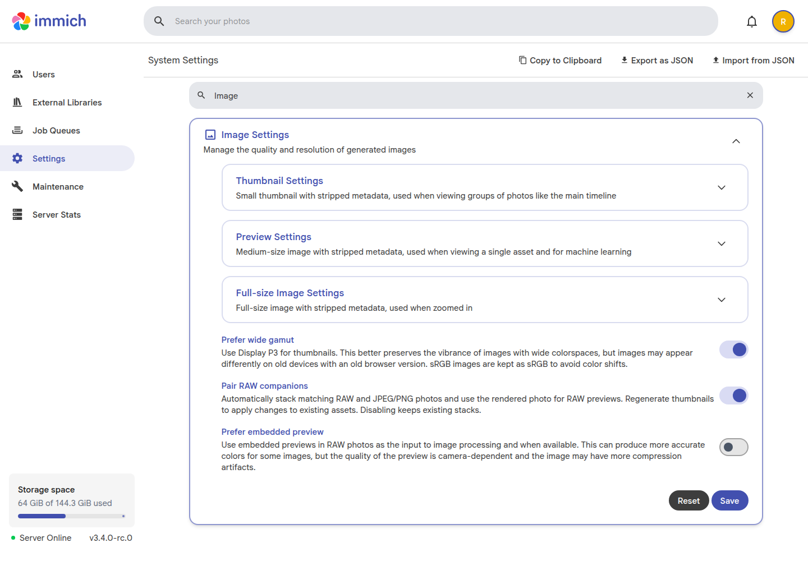
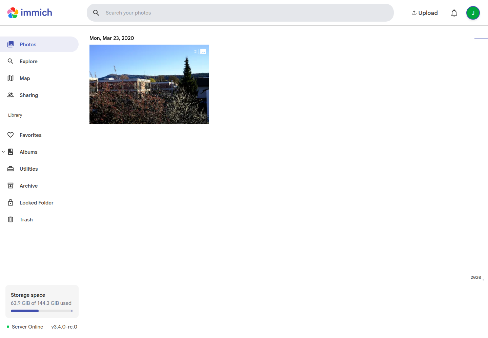
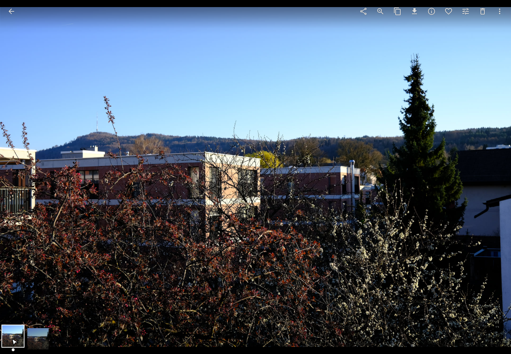
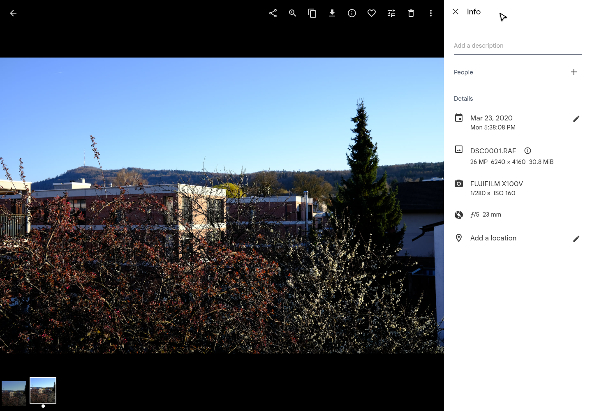
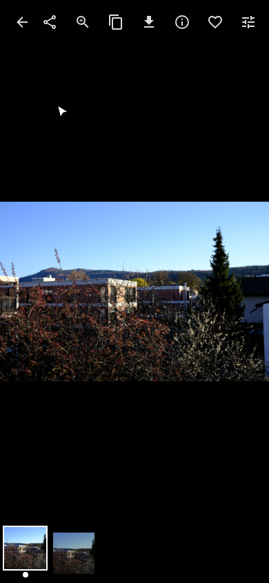

# RAW + JPEG companions

Import `DSC0001.RAF` and `DSC0001.JPG` and Immich groups them into one stack, with the JPEG displayed first. PNG companions work too. Both originals remain available. Pairing starts enabled in **Image Settings → Pair RAW companions**. No enable flag or custom client is required.

This fork includes upstream `main` through [`0cb2ab23`](https://github.com/immich-app/immich/commit/0cb2ab23b8c1669cc0a39e2247c62bdaceb0150d), whose server version is **3.4.0-rc.0**. The old fork main was 864 upstream commits behind and has been fast-forwarded. The feature adds **no schema migrations relative to that main commit**. Upstream main itself adds migrations beyond stable v3.3.6: do not treat this image as a migration-free v3.3.6 replacement.

The feature-only change is [fork PR #1](https://github.com/ajnart/immich-slop-fork/pull/1), from `feat/raw-companion-stacking` into `review/upstream-main`. This fork’s `main` already contains an earlier implementation, so the PR uses the clean upstream commit as its review base to show the whole feature. Documentation, demos, and validation workflows remain on `main` and are excluded from that PR.

## See it working

1. Open **Image Settings → Pair RAW companions**. It is on by default. Toggle it and choose **Save** when you want to change automatic pairing.



Watch the [settings video](assets/raw-companions/settings.mp4). It shows saving the setting off and on, with each choice preserved after reloading the page.

2. Upload the matching files. The timeline shows one photo for the pair.



3. Open the photo. The JPEG is the primary, with both files in the stack strip.



4. Select the RAW in the strip and open Info. Its original filename and dimensions are still available.



Watch the [combined walkthrough](assets/raw-companions/walkthrough.mp4) (21.77 seconds), or use the separate [desktop video](assets/raw-companions/desktop.mp4) and [phone-sized web video](assets/raw-companions/mobile-web.mp4). [The successful browser run](https://github.com/ajnart/immich-slop-fork/actions/runs/42331405731) used the exact image below, verified the normal setting starts enabled without an enable flag, and preserved the account and stack across a full Compose recreation.

The walkthrough uses real Fujifilm RAF data and its embedded JPEG in the actual Immich web UI. It opens the JPEG primary, selects the RAW companion, inspects both filenames, and switches back to the JPEG. The browser recording is a real capture, not a rendered mockup. The landscape uses a CC0 sample from [raw.pixls.us](https://raw.pixls.us/); its exact source, checksum, image revision, and test results are recorded in [report.json](assets/raw-companions/report.json).

## Try it separately from your library

Use a disposable local instance first. These commands use separate Docker volumes, bind only to localhost, and do not connect to your existing database or media. They require Docker Compose and Linux amd64; the server image is not built for ARM yet.

```bash
git clone --depth 1 --branch main https://github.com/ajnart/immich-slop-fork.git
cd immich-slop-fork
export SLOP_IMAGE='ghcr.io/ajnart/immich-slop-fork@sha256:ce8687908aeb4ef7185e6a33a8024fbbb476244b49d77bddf997a7bd509c4cda'
export SLOP_PORT=2284
docker compose -p immich-raw-demo -f .github/slop-fork-smoke.yml up -d --wait
```

Open **http://localhost:2284**, create the local account, and upload a matching RAW and JPEG/PNG pair. Open the photo and use the stack strip to select either original. Repeat with the opposite upload order. Stop the demo without deleting its files:

```bash
docker compose -p immich-raw-demo -f .github/slop-fork-smoke.yml down
```

The cloned `main` branch supplies the isolated demo Compose file; the pinned image comes from the reviewed feature commit. The demo is for localhost testing, not a production installation. Keep your source photos. No registry login is needed for the published image.

## Matching and processing

A pair must have exactly one RAW and one JPEG/PNG with the same case-sensitive filename stem, owner, and library. Uploaded pairs need matching capture time, camera make, and model. External-library pairs must share a directory and must not have conflicting metadata. Archive visibility and favorite status must agree. Ambiguous matches, edited/offline/trashed assets, Live Photos, and incompatible existing stacks are skipped.

The JPEG/PNG becomes the primary. Each original keeps its own generated files, so deleting one original cannot remove the other's preview. The RAW thumbnail job uses the rendered companion instead of decoding the RAW. RAW arriving first may still be decoded before its companion exists. This saves RAW decoding work; it does not deduplicate original or thumbnail storage.

Existing pairs are considered when their thumbnails are regenerated. Start with a small selection. Successfully switching a RAW preview refreshes search, faces, OCR, and clients through Immich's job pipeline. Unstacking does not create a permanent exclusion: a later thumbnail reprocessing can pair the files again. To stop automatic pairing and companion-source processing, turn off **Image Settings → Pair RAW companions** and choose **Save**. The saved setting applies to subsequent jobs without recreating the server. Existing stacks and originals remain.

## Mobile

The same stack can be opened and switched in the responsive web interface at 390×844. The browser test checks both displayed images, filenames, stack members, and that the timeline fits the viewport.



The feature uses Immich's existing stack records and sync APIs. The native client already supports those stacks; this fork does not change the native app or require a custom mobile build. Native iOS/Android device testing is not part of the browser recording, so it is not claimed here.

Apple Photos may represent a RAW/JPEG pair as one asset. Immich's current iOS uploader selects one resource from that asset; this server feature cannot upload a resource the client did not send. Export/upload both files separately when needed. Ordinary separate RAW/JPEG uploads can pair once both reach the server and pass the matching checks.

## Production checkpoint and rollback

Before changing an existing installation, record its exact running image ID/digest, Compose files and environment. Stop server writes and take matching database and media backups using [Immich's backup procedure](https://docs.immich.app/administration/backup-and-restore/). Preserve external-library originals too. Keep the old image locally so a mutable tag cannot change the rollback target.

This build tracks upstream main rather than a stable release. Follow upstream compatibility requirements for clients, database, machine learning, and other services. A version label alone does not prove two main builds share the same schema. Test an upgrade using a copy of your database/media before changing production.

For a same-schema image rollback, restore the exact old image and configuration. Switching the image does not undo created stacks or generated previews. If upstream migrations ran, restore the matching pre-upgrade database **and** media backup together; do not assume a downgrade is safe. Never remove your production volumes as an ordinary rollback step.

Repository checkpoints:

- `slop-checkpoint/fork-main-before-sync`: original fork main `534b8746`.
- `slop-checkpoint/upstream-main-0cb2ab23`: exact upstream baseline.
- `slop-checkpoint/verified-feature-681024b1`: source of the fully validated image with the normal Image Settings toggle.
- `slop-checkpoint/verified-main-b78b2af9`: the earlier environment-controlled default-on image, before the normal Image Settings toggle was added.
- `slop-checkpoint/pre-main-sync`: feature branch before the upstream update.
- `slop-checkpoint/v3.3.6`: earlier stable baseline. Its [historical instructions and image](https://github.com/ajnart/immich-slop-fork/blob/351e3d5b493ca432f8cbc62c809f1e31b5b4d77b/SLOP-FORK.md) describe the older opt-in build, not the current default-on one.

## Validation and review

[Successful feature validation run](https://github.com/ajnart/immich-slop-fork/actions/runs/42329212979) checks exact source [`681024b1a`](https://github.com/ajnart/immich-slop-fork/commit/681024b1aee414f8be8450f56b1fb24d9bac6837).

| Suite | Files | Passed tests |
| --- | ---: | ---: |
| Server unit | 111 | 2,564 |
| Database | 71 | 861 |
| Web unit | 55 | 480 |

Server build, type checking, formatting, and lint passed. Web TypeScript, formatting, lint, and production build passed; Svelte checking reported zero errors and warnings. Regenerated OpenAPI and TypeScript clients matched the committed files, and Dart client generation passed. The server unit suite retains one upstream expected-failure case and one skipped test; the web suite has no skipped tests.

The published Linux amd64 image passed real RAF/JPEG imports in both orders, unchanged original-download checksums, and RAW thumbnail survival after JPEG deletion. Saving **Pair RAW companions** off and restarting preserved the existing stack and originals while fresh imports remained unstacked. Upgrading the earlier fork’s seeded v3.3.6 database and media to the new image preserved the existing stack and originals, applied the new setting’s default, and retained a saved disabled setting across restart. The registry manifest and image configuration were anonymously readable; their source revision and `IMMICH_SOURCE_COMMIT` matched `681024b1a`.

[The full code review](SLOP-REVIEW.md) records the fixed RAW-only refresh gap, configuration and mobile compatibility checks, demo database persistence, and remaining limits. Against the clean review base, PR #1 changes 17 files: 1,207 added and 17 removed lines, including 916 added lines of tests and fixtures. It contains no demo, documentation, branding, or workflow files.

The [feature validation workflow](.github/workflows/slop-fork-feature.yml) lives on `main` and checks out the exact minimal feature commit for code generation, complete server and web suites, static checks, and the full image build. It verifies that the feature changes no schema, migrations, Dockerfile, or workflow files relative to its clean upstream base. Publication follows runtime checks for import order, original downloads, deletion safety, the saved Image Settings toggle, restart preservation, and an upgrade from the earlier seeded v3.3.6 build. It does not deploy to your server.

The [browser demo workflow](.github/workflows/slop-fork-demo.yml) uses pinned `agent-browser@0.41.2` and [this JavaScript script](.github/scripts/slop-fork-browser-demo.mjs). It runs against the published image, records H.264 MP4 videos, captures screenshots and accessibility snapshots, and produces a machine-readable report. Each run uses disposable accounts and storage. Credential state stays outside the uploaded evidence directory, and snapshots and browser errors redact transient account secrets.

Agent-browser and its global Codex discovery skill can be installed with:

```bash
npm install -g agent-browser@0.41.2
agent-browser install
npx skills add vercel-labs/agent-browser --global --agent codex --yes
```

## Design context

The [automatic-stacking discussion](https://github.com/immich-app/immich/discussions/2479#discussioncomment-18055821) covers a broader feature. Its [maintainer-direction update](https://github.com/immich-app/immich/discussions/2479#discussioncomment-19232700) points toward plugins/workflows; [metadata duplicate detection #31286](https://github.com/immich-app/immich/pull/31286) was closed. This fork limits the change to RAW/rendered companions and thumbnail processing, using existing stack records without changing duplicate detection.

The baseline includes [primary-selection fix #31380](https://github.com/immich-app/immich/pull/31380). The approach follows [PhotoPrism's rendered-preview preference](https://docs.photoprism.app/user-guide/organize/stacks/) while retaining Immich's independent asset ownership.
